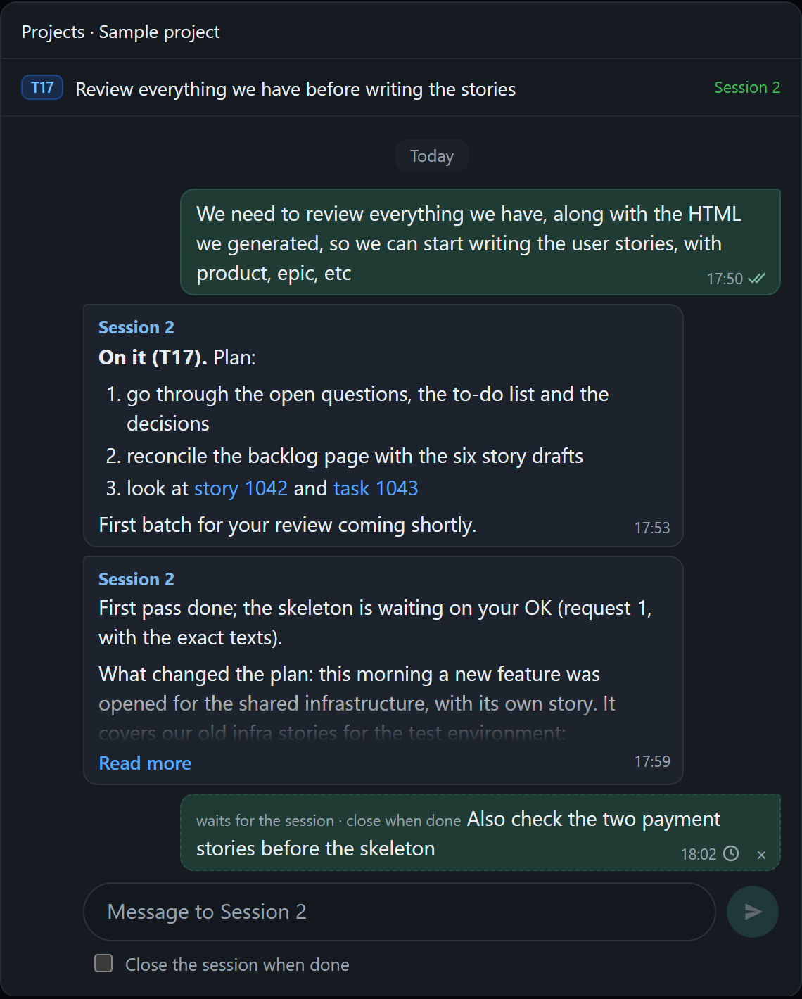
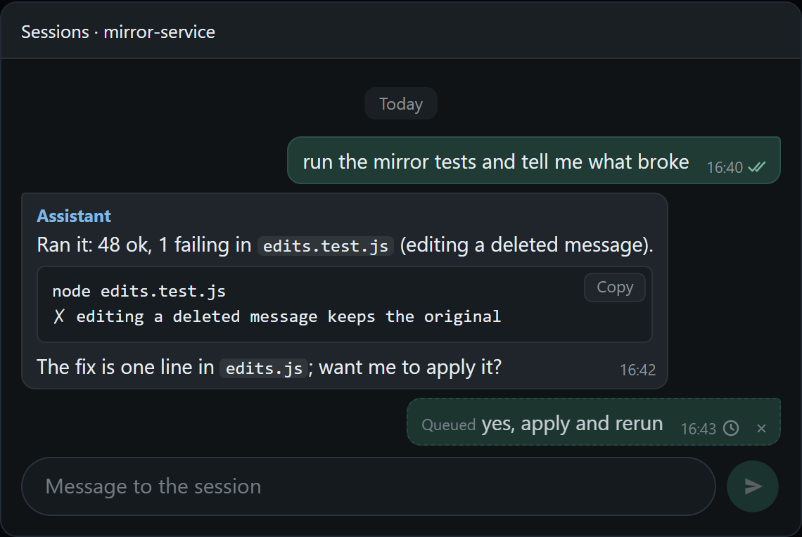
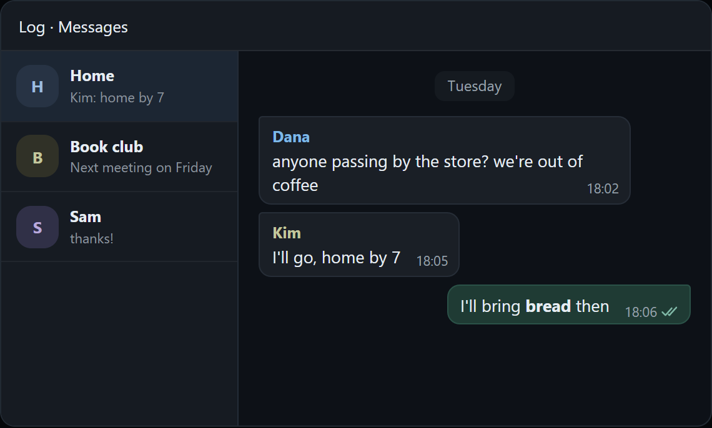
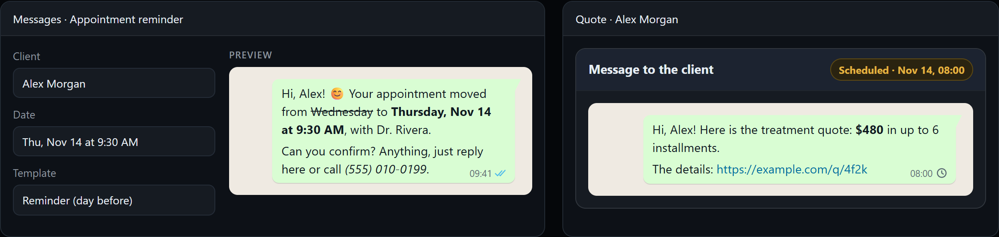
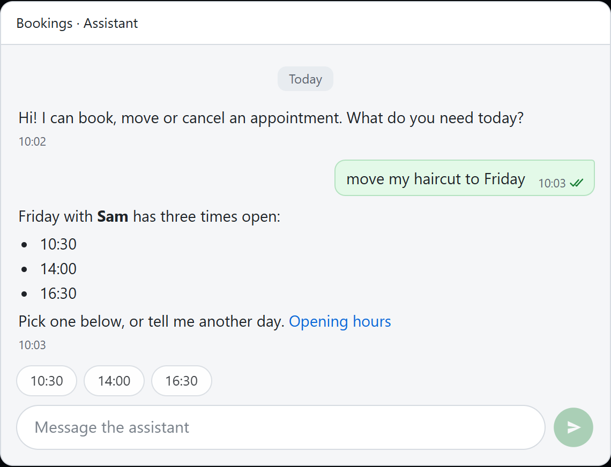
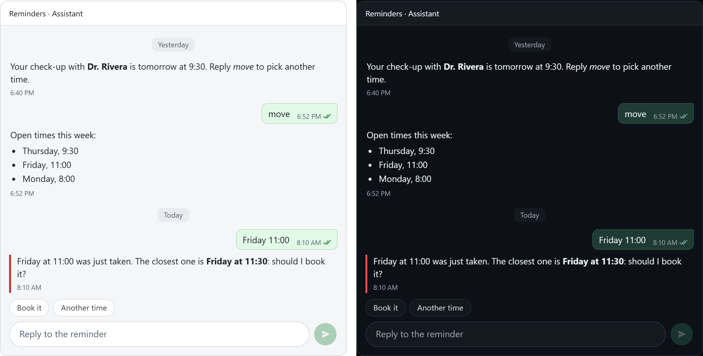

# chat-thread

A WhatsApp-style conversation thread for any app that talks: to a person, a group, an AI or a background job. My messages on the right with time and ticks, the other side on the left with its name, a safe markdown subset with copyable code, and a pill box that grows as you type.

[](https://github.com/rbritta/chat-thread/actions/workflows/ci.yml) [](https://github.com/rbritta/chat-thread/releases) [](LICENSE) [](https://rbritta.github.io/chat-thread/demo/)



**[Live demo](https://rbritta.github.io/chat-thread/demo/)** · [Install](#install) · [Quick start](#quick-start) · [Options](#options) · [Messages](#messages) · [Themes](#themes) · [Server](#server) · [For AI agents](AGENTS.md) · [Roadmap](TODO.md)

## What it does

Vanilla JS, zero runtime dependencies, about 81 kB unminified (26 kB gzipped) plus 23 kB of CSS. The HTML comes from a pure function, so a server draws the same thread the browser does. A SQLite store and an HTTP handler for Node come with it.

- **Sides, not labels.** Mine on the right in green, theirs on the left with the author's name (a session, an AI, each person in a group, each with a color if you want). The corner on the author's side is almost square.
- **Time and ticks inside the bubble**, at the end of the last line: a clock while pending or queued, one tick sent, two delivered, two in color read.
- **Markdown for answers, plain text for me.** Headings, lists, code blocks with a **Copy** button, `code`, **bold**, *italic*, ~~strike~~, links. Raw HTML is never rendered, and what I typed stays exactly as I typed it.
- **WhatsApp marks** (`*bold*`, `_italic_`, `~strike~`, ` ```mono``` `) for previews and logs of real WhatsApp messages.
- **Long messages fold** behind "Read more", and unfold if they fit after all.
- **Typing dots** and "… has not replied yet". The dots look like the other side: in a bubble, or bare for a side that narrates in notes. A reply clears both.
- **Day separators:** Today, Yesterday, the weekday, then the date, in your time zone and language.
- **Queued, failed and alert messages:** a message waiting for its turn is dashed with a clock and a × to take it back; one that could not be sent gets a red border and a red mark ("Not sent"); an alert gets a red border.
- **Quiet motion:** a new message fades in, a removed one folds away, "Read more" unrolls; short and eased, and none at all with `prefers-reduced-motion`.
- **Accessible:** the thread is a log that announces new messages (not reloads), every button has a label, the focus stays in the box after sending, Ctrl+Enter sends when Enter does not, and every theme passes WCAG AA (the tests measure it).
- **A box that behaves:** a pill that grows from one to six lines, Enter sends, Shift+Enter breaks the line, a round Send button that stays off while empty, suggestion chips above it and checkboxes below it.
- **Notes without a bubble:** a bot or a system that narrates writes across the whole width with `kind: 'note'`, while the person's messages stay in bubbles.
- **Three modes:** `chat`, `readonly` (a log, no box) and `preview` (what the other phone will show).
- **Dark, light or auto.** Dark green by default, `light` for light apps, `auto` to follow the page's `data-theme` or the system, and `whatsapp` for the WhatsApp look with the tail and blue ticks. All of it is CSS variables: repaint for your app by setting a few `--ct-*` properties.
- **CSP-safe.** No `eval`, no inline styles or handlers in the markup, data in by JSON. The demo runs under `default-src 'self'`.
- **Phones too.** No horizontal scroll at 360 px; code blocks scroll inside their bubble.

<p>
  
  
</p>
<p>
  
  
</p>

## Install

```sh
npm install github:rbritta/chat-thread
```

No runtime dependencies. Pin a commit (`github:rbritta/chat-thread#<commit>`) or a release tag for repeatable installs. The package exports `chat-thread` (the browser API), `chat-thread/core` (pure rendering, no DOM), `chat-thread/server` (the SQLite store and the HTTP handler, Node 22.5+), `chat-thread/style.css`, and the bundles `chat-thread/global` and `chat-thread/bundle`.

No bundler and no modules? Use the classic build, which defines `window.ChatThread`:

```html
<link rel="stylesheet" href="dist/chat-thread.css">
<script src="dist/chat-thread.global.js"></script>
<script>ChatThread.createChat(el, { store: ChatThread.memoryStore() });</script>
```

`dist/chat-thread.mjs` is the same code as a single ES module.

## Quick start

```html
<link rel="stylesheet" href="node_modules/chat-thread/src/chat-thread.css">
<div id="chat"></div>

<script type="module">
  import { createChat, restStore } from 'chat-thread';

  const chat = createChat(document.getElementById('chat'), {
    store: restStore('/api/chat/support'),        // or memoryStore(), localStore('name'), or your own
    author: 'Assistant',                           // the name on the other side
    strings: { placeholder: 'Ask anything' },
    chips: ['Summarize', 'What changed?'],
  });
  chat.reload();                                   // loads the messages from the store

  // later, from your own channel (SSE, WebSocket, polling):
  chat.setTyping(true);
  chat.append({ from: 'other', text: 'All **4** backups ran.' });
</script>
```

### Drawn on the server

```js
import { renderThread } from 'chat-thread/core';      // pure: no DOM, no I/O

const html = renderThread(messages, { author: 'Assistant', timeZone: 'Europe/London', locale: 'en-GB' });
// send html inside your page, then in the browser:
createChat(container, { hydrate: true, onSend: (text) => post(text) });
```

The thread carries its options in its markup (`data-options`: only the ones that differ from the defaults), so the browser draws new messages, times, day separators and every word the way the server did without being told again; options given to `createChat` win. The typing and waiting lines the server drew are taken over too, and a reply clears them. To change a server-drawn message with `updateMessage`, pass the same `messages` to `createChat`: the script cannot read them back from the HTML.

### A preview, no script at all

```js
el.innerHTML = renderThread([{ from: 'me', text: 'Hi, *Alex*! See you ~Wed~ _Thu_.' }], { mode: 'preview', theme: 'whatsapp', format: 'whatsapp' });
```

## Options

| Option | Default | What it is |
| --- | --- | --- |
| `messages` | `[]` | The messages to draw, if you load them yourself instead of `reload()`. See [Messages](#messages). |
| `store` | `null` | Where sending and removing go: `restStore(url)`, `memoryStore(list)`, `localStore(name)` or your own `{ load, send, remove? }`. |
| `mode` | `'chat'` | `chat` (with the box), `readonly` (no box) or `preview` (no box, no day separators). |
| `theme` | `'dark'` | `light`, `auto` or `whatsapp`: see [Themes](#themes). Any other name adds the class `ct--<name>` for your own CSS. |
| `format` | `'auto'` | `auto`: markdown for the other side, plain for mine. Or `markdown`, `whatsapp`, `plain` for every message. A message can set its own. |
| `author` | `''` | The name shown on the other side when a message has none. Also used by `setTyping(true)` and `setWaiting(true)`. |
| `colorAuthors` | `false` | Give each author in a group a stable color (six slots, `--ct-author-1` to `-6`). |
| `ticks` | `true` | Show the ticks on my messages. |
| `days` | not in `preview` | Day separators. |
| `clamp` | `500` | Characters (or 10 lines) after which a message starts behind "Read more". `0` turns it off. |
| `copy` | `true` | The Copy button on code blocks. |
| `chips` | `[]` | Suggestion chips: strings, or `{ label, text?, fill? }`. A chip sends its text; with `fill` it puts it in the box instead. |
| `toggles` | `[]` | Checkboxes under the box: `{ name, label, checked? }`. Their values go with every message in `meta.toggles`. |
| `enterSends` | `true` | Enter sends and Shift+Enter breaks the line. `false` leaves Enter alone (Ctrl+Enter or Cmd+Enter still sends). |
| `sendState` | none | The state a new message starts with in the store, e.g. `'queued'` while the other side is busy. |
| `autoScroll` | `true` | Bring a new message into view. |
| `typing`, `waiting` | `false` | Start with the typing dots or the waiting line: `true` or a name. |
| `typingKind` | `'auto'` | The shape of the typing dots: `bubble`, `note` (bare dots, no name, for a side that narrates) or `auto`, the shape of the other side's last message (a bubble when there is none). |
| `strings` | English | Every visible word, e.g. `{ placeholder: 'Write a reply', send: 'Post', today: 'Earlier today' }`, or a translation. See `DEFAULT_STRINGS`. |
| `locale` | browser | Language of the day separators and times (`'en-GB'`, `'en-US'`…). See [Dates and times](#dates-and-times). |
| `timeZone` | browser | Time zone of the times and days, e.g. `'America/Sao_Paulo'`. Pass it when rendering on a server. |
| `hour12` | the locale's | `true` for `5:50 PM`, `false` for `17:50`; left out, the locale decides. |
| `hydrate` | `false` | Take over a thread already in the element (from `renderThread`) instead of drawing it, with the options it was drawn with. |
| `onSend` | none | `(text, { toggles, message, chat })` after a message is sent. Return a message object to replace the draft (its `id`, `state`...). Throw to mark it failed (`state: 'failed'`, a red mark labelled "Not sent"). |
| `onRemove` | none | `(message)` when × takes back a queued message. |
| `onChange` | none | Every `send`, `append`, `remove` and `load`. |
| `onError` | `console.error` | Called when the store or a callback fails. The thread also fires a `chat-error` event. |
| `now` | `() => new Date()` | The clock, for tests. |

The returned chat has `append(message)`, `updateMessage(id, patch)`, `update({ messages?, typing?, waiting? })`, `setTyping(value)`, `setWaiting(value)`, `send(text)`, `reload()`, `configure(options)`, `focus()`, `messages`, `el`, `composer` and `destroy()`. A message from the other side passed to `append` clears the typing dots and the waiting line. A message whose `id` is already in the thread changes that one instead of adding a copy, so a live feed that echoes what was just sent shows it once. `configure` keeps the text being typed, the toggles' boxes and the focus; its `strings` merge with the ones already given. `destroy` takes out the thread and nothing else in the element.

`core.js` exports the pure pieces: `renderThread`, `renderList`, `renderMessage`, `renderComposer`, `renderTyping`, `renderMarkdown`, `renderWhatsApp`, `renderPlain`, `normalizeMessage`, `formatTime`, `dayKey`, `dayLabel`, `escapeHtml`, `safeUrl`, `linkify`, `DEFAULT_STRINGS`, `DEFAULTS`, `KINDS`, `STATES` and `LIMITS`.

## Messages

```js
{
  id,          // number or string, stable: the × and updateMessage use it
  from,        // 'me' (right) or 'other' (left)
  kind,        // 'bubble' (default) or 'note': no bubble, the whole width
  author,      // the name on the left: 'Assistant', 'Session 2', 'Dana'
  text,        // up to 20,000 characters
  at,          // ISO time
  state,       // my side: 'pending' | 'queued' | 'sent' | 'delivered' | 'read' (none counts as read) | 'failed'
  alert,       // true: red border
  tag,         // a small label before the text: 'waits for the session'
  title,       // a line above the text: 'Note of the day'
  format,      // 'markdown' | 'whatsapp' | 'plain', to override the thread's
  meta,        // your own object, kept by the stores
}
```

### Notes: a narrator without a bubble

```js
chat.append({ from: 'other', kind: 'note', text: 'Friday has **three** times open:\n- 10:30\n- 14:00' });
```

A note is the other side telling what happens, the way a booking bot or a setup assistant talks: no bubble, no author line, no ticks, across the whole width in the theme's text color. It is markdown on either side, and Read more, Copy, `title`, `tag` and `alert` (a bar on the left) work as in a bubble. When the message has `at`, its time sits below the text in the muted color; `--ct-note-meta: none` hides it. `renderThread` draws the same note on a server. For a bot that only narrates, give its messages `kind: 'note'` in the app's mapping function and leave the person's as bubbles. While it writes, its typing dots are bare too, on the left with no bubble and no name: `typingKind: 'auto'` (the default) takes the shape of the other side's last message, and `typingKind: 'note'` asks for it before there is one.

## Dates and times

In the browser, the thread writes times and day separators the way the person's browser does: in its language, in its time zone and with its clock (`17:50` in Brazil, `5:50 PM` in the United States). Nothing to set for that. An app that wants something else says so:

```js
createChat(el, { locale: 'en-GB', strings: { today: 'Earlier today' } }); // "Earlier today", "Friday", 17:50
createChat(el, { timeZone: 'America/Sao_Paulo' });     // the day and hour in Sao Paulo, wherever the browser is
createChat(el, { locale: 'en-US', hour12: false });    // American words with a 24-hour clock
chat.configure({ hour12: true });                       // change it later; the times redraw
```

- `locale` picks the words of the day separators (the weekday, then the date) and, unless `hour12` says otherwise, 12 or 24 hours as that language writes them. "Today" and "Yesterday" are `strings` (`today`, `yesterday`).
- `timeZone` decides the day as well as the hour: a message sent at 01:30 UTC sits under "Today" in London and under "Yesterday" in São Paulo.
- A locale or a zone the runtime does not know falls back to the runtime's own, one at a time, instead of throwing.
- **On a server there is no browser to follow.** `renderThread` there uses the server's own language and zone, which are rarely the reader's. Pass the reader's `locale` and `timeZone` (from the account, a cookie, or `Accept-Language`), or fix them for the whole app. The thread carries them in `data-options`, so the messages the browser adds later read the same.

## Threads

Several subjects in one place, each a full thread under a header: a support desk with one thread per issue, a team channel, an AI session with numbered questions.

```js
import { createThreads } from 'chat-thread';

const box = createThreads(element, {
  threads: [
    { id: 't1', at: '2026-11-13T09:10:00Z', status: 'resolved', resolvedBy: 'Ana', participants: [{ name: 'Ana' }], messages: [...] },
    { id: 't2', at: '2026-11-14T10:02:00Z', tone: 'wait', participants: [{ name: 'Ana' }, { name: 'Assistant' }], messages: [...] },
  ],
  chat: { author: 'Ana', theme: 'auto' },                 // the options of every thread's createChat
  onSend: (id, text) => api.send(id, text),               // like createChat's onSend, with the thread
  onNewThread: (text, parentId) => api.open(text, parentId), // returns the new thread (or a promise of it)
  onResolve: (id) => api.resolve(id),
});

box.upsert({ id: 't2', tone: 'busy', activity: 'Looking it up' });  // typing dots and an activity line
box.append('t2', { from: 'other', author: 'Ana', text: 'Done.' });
box.resolve('t2', 'Ana');                                           // from outside, too
box.rename('t2', 'Hosting charged twice', 'Assistant', true);       // an AI's title gets the ✦ mark
```

- **Order:** threads stay in the order they were opened (`at`). A resolved thread folds into one line in its place, hidden behind "Show N resolved" at the top.
- **One message box:** only the active thread (the open one you last touched) has a box. With none open, a box at the bottom starts a new thread; what you type there goes to the new thread.
- **Branch:** the button right of Send, or Ctrl+Shift+Enter, opens a new thread with the text instead of sending it, derived from the thread you are in (`onNewThread(text, parentId)`; the header shows where it came from).
- **Title:** what someone gave (`title`, renamed with the pencil or `rename()`); without one, the first line of the first message. `titleByAI` marks a title an AI gave.
- **State:** `tone` is `wait` (your turn), `busy` (the other side is working: typing dots, and `activity` above the box), or `idle`. `label` replaces the words.
- **Headers:** `mode: 'conversation'` (the default: avatars, title, who, how many, when, for people with or without an AI in between) or `mode: 'questions'` (a badge `Qn` colored by the state, with `n` and `origin`, for AI sessions). `header: (thread, { strings, preview, when, escapeHtml, headers }) => html` draws your own; call `headers.conversation(thread, ctx)` inside it to start from the default.
- **Words:** `strings` over `THREAD_STRINGS`; the threads' own messages use `chat.strings`.
- **Colors:** `--ct-th-*` custom properties on the container, with the same `theme` (`dark`, `light`, `auto`) as the thread.

- **Long threads:** each shows its last `latest` messages (2 by default; `0` shows all) with "Show N earlier messages" above them.

The controller also has `threads()`, `get(id)`, `chat(id)` (that thread's createChat controller), `remove`, `reopen`, `open`, `close`, `updateMessage(id, messageId, patch)`, `setMode`, `setHeader`, `active` and `destroy`.

## Themes

| `theme` | What it is | For |
| --- | --- | --- |
| `dark` (default) | The dark green palette | Dark apps |
| `light` | Its light twin: soft green for mine, white for theirs, near-black text. Text, muted text and links pass WCAG AA on both bubbles and on `#f5f6f8` | Light apps |
| `auto` | `dark` or `light`, chosen by the page, with CSS only | Apps with their own light/dark switch, or none |
| `whatsapp` | The light WhatsApp look, with the tail and blue ticks | Previews of what the other phone will show |



`auto` follows one convention, the one most sites with a theme switch already use:

1. `<html data-theme="light">` makes it light, `<html data-theme="dark">` makes it dark.
2. With no `data-theme` (or any other value), the system decides through `prefers-color-scheme`.
3. Without a word for light from either, it stays dark.

An app whose switch sets `data-theme` on `<html>` needs nothing more: the thread changes with the page, no script involved. The [live demo](https://rbritta.github.io/chat-thread/demo/) works this way: its System / Light / Dark switch at the top repaints every example. An app that marks its theme some other way (a class, another attribute) can also set `data-theme`, or pass `theme: 'light'` or `'dark'` itself and call `chat.configure({ theme })` when its switch changes. Its own `--ct-*` properties on the container always win over `light` and `auto`.



## Styling

Everything is a custom property on `.ct`. Set a few on your container to fit your app:

```css
.my-panel .ct { --ct-theirs: #1c232c; --ct-theirs-border: #2a323d; --ct-font-size: 13.5px; }
```

The main ones: `--ct-mine`, `--ct-mine-border`, `--ct-theirs`, `--ct-theirs-border`, `--ct-text`, `--ct-muted`, `--ct-tick`, `--ct-link`, `--ct-hover`, `--ct-author`, `--ct-title`, `--ct-field`, `--ct-field-border`, `--ct-focus`, `--ct-send`, `--ct-alert`, `--ct-day`, `--ct-font`, `--ct-font-size`, `--ct-max-width`, `--ct-note-meta`. Links have no underline and turn `--ct-hover` (`#6e7681`) on hover. The thread has no background of its own: it sits on yours.

## Server

```js
import { DatabaseSync } from 'node:sqlite';              // or better-sqlite3
import { createSqliteStore, createHttpHandler } from 'chat-thread/server';

const store = createSqliteStore(new DatabaseSync('chat.db'), {
  onChange: ({ type, thread, message }) => { if (type === 'add' && message.from === 'me') answer(thread, message); },
});
const handle = createHttpHandler(store, { prefix: '/api/chat' });

http.createServer(async (req, res) => {
  // authenticate and check CSRF first: the handler trusts whoever reaches it
  if (await handle(req, res)) return;
  // ...the rest of your app
}).listen(3000);

// your app writes the other side:
store.add('support', { from: 'other', author: 'Assistant', text: 'Done.' });
```

| Route | Body | Answer |
| --- | --- | --- |
| `GET /api/chat` | | `{ threads: [{ thread, count, last }] }` |
| `GET /api/chat/:thread` | `?limit=200&before=<id>` | `{ messages }`, oldest first |
| `POST /api/chat/:thread` | `{ text, state?, meta? }` | the message, always `from: 'me'`; `state` only `pending`, `queued` or `sent` |
| `PATCH /api/chat/:thread/:id` | `{ removed: true }` | `{ ok, id }`, only for my own messages |

The browser can only write as `me`, and only bubbles; notes (`store.add(thread, { kind: 'note', text })`), replies and state changes (`store.update(thread, id, { state: 'read' })`, a streamed `{ text }`) come from your server. If a framework already read the body, `req.body` is used. Nothing is deleted: removed messages keep their row with a timestamp. `onChange` gets every `add`, `update` and `remove`. A table made by 0.1.0 gets the `kind` column the first time a store opens it.

## Part of a small family

Each works alone; together they need no glue code.

| Project | What it does |
| --- | --- |
| [ai-signalbox](https://github.com/rbritta/ai-signalbox) | A coordination layer for several AI coding sessions on one machine: who is doing what, shared resources, asks and threads with the person. |
| [ai-threads](https://github.com/rbritta/ai-threads) | Numbered threads between a person and one AI coding session, and the delivery of each message into it. |
| **chat-thread** | The conversation on screen: bubbles, ticks, threads and the message box. ai-threads' `view()` returns threads in the shape its `createThreads` takes. |
| [postit-board](https://github.com/rbritta/postit-board) | A glass board of sticky notes for an app's home screen, with notes the app pins and takes down by itself. |
| [claude-session-relay](https://github.com/rbritta/claude-session-relay) | Drive the Claude Code tabs of any VS Code window from a script, a bot or a web panel, through a plain file inbox. |

## Develop

```sh
git clone https://github.com/rbritta/chat-thread.git && cd chat-thread
npm ci                 # only playwright-core, for the browser tests and screenshots
npm test               # core, server and browser tests (an installed Chrome; PW_CHANNEL=msedge for Edge)
npm run test:coverage  # the same, with a coverage summary of the code Node runs
npm run demo           # http://localhost:5179/demo/
npm run build          # dist/ (commit it: script-tag users take it from the repo)
npm run screenshots    # regenerates docs/*.png from the demo
```

Node 22.5 or newer (for `node:sqlite` in the tests). 86 tests: 44 run in Node (the core, the server, the release notes) and 42 in a real browser. The browser tests pin the language, the time zone and the clock, so they give the same result on any machine; with no browser installed they skip and say why (CI makes that an error). Why the library looks the way it does: [docs/extraction.md](docs/extraction.md).

## Contributing

Issues and pull requests are welcome; keep it dependency-free. [CONTRIBUTING.md](CONTRIBUTING.md) has the setup, what a pull request needs and how releases are made, and [SECURITY.md](SECURITY.md) how to report a vulnerability privately. Everyone taking part follows the [Code of Conduct](CODE_OF_CONDUCT.md).

## License

[MIT](LICENSE)
