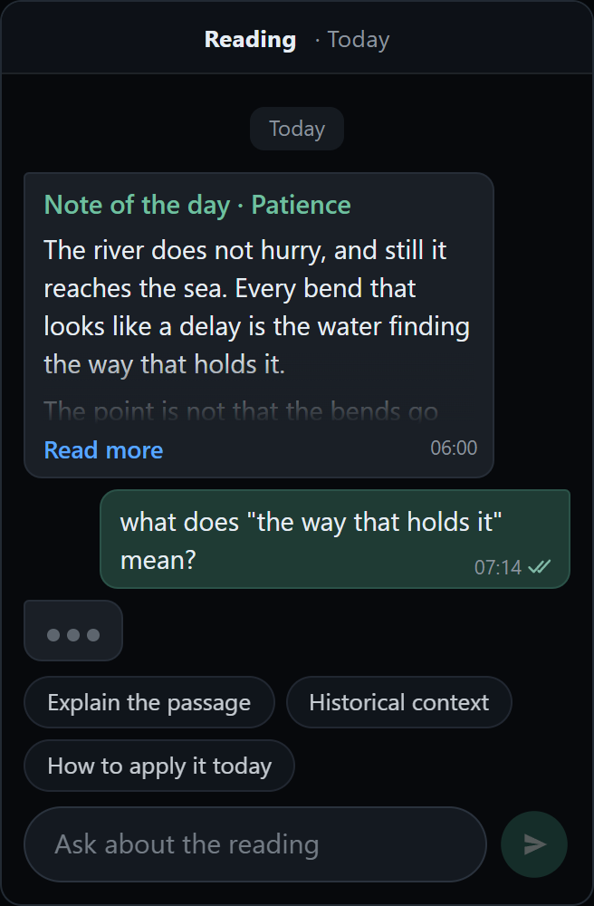

# chat-thread

A WhatsApp-style conversation thread for any app that talks: to a person, a group, an AI or a background job. My messages on the right with time and ticks, the other side on the left with its name, a safe markdown subset with copyable code, and a pill box that grows as you type.

Vanilla JS, zero runtime dependencies, about 38 kB unminified. The HTML comes from a pure function, so a server draws the same thread the browser does. A SQLite store and an HTTP handler for Node come with it.


**[Live demo](https://rbritta.github.io/chat-thread/demo/)** · [Use it](#use-it) · [Options](#options) · [Messages](#messages) · [Server](#server) · [For AI agents](AGENTS.md) · [Roadmap](TODO.md)

## What it does

- **Sides, not labels.** Mine on the right in green, theirs on the left with the author's name (a session, an AI, each person in a group, each with a color if you want). The corner on the author's side is almost square.
- **Time and ticks inside the bubble**, at the end of the last line: a clock while pending or queued, one tick sent, two delivered, two in color read.
- **Markdown for answers, plain text for me.** Headings, lists, code blocks with a **Copy** button, `code`, **bold**, *italic*, ~~strike~~, links. Raw HTML is never rendered, and what I typed stays exactly as I typed it.
- **WhatsApp marks** (`*bold*`, `_italic_`, `~strike~`, ` ```mono``` `) for previews and logs of real WhatsApp messages.
- **Long messages fold** behind "Read more", and unfold if they fit after all.
- **Typing dots** and "… has not replied yet". A reply clears both.
- **Day separators:** Today, Yesterday, the weekday, then the date, in your time zone and language.
- **Queued and alert messages:** a message waiting for its turn is dashed with a clock and a × to take it back; an alert gets a red border.
- **A box that behaves:** a pill that grows from one to six lines, Enter sends, Shift+Enter breaks the line, a round Send button that stays off while empty, suggestion chips above it and checkboxes below it.
- **Three modes:** `chat`, `readonly` (a log, no box) and `preview` (what the other phone will show).
- **Themes are CSS variables.** Dark green by default; `theme: 'whatsapp'` is the light WhatsApp look, with the tail and blue ticks. Repaint for your app by setting a few `--ct-*` properties.
- **CSP-safe.** No `eval`, no inline styles or handlers in the markup, data in by JSON. The demo runs under `default-src 'self'`.
- **Phones too.** No horizontal scroll at 360 px; code blocks scroll inside their bubble.

<p>
  
  
</p>
<p>
  
  
</p>

## Use it

```sh
npm install github:rbritta/chat-thread
```

```html
<link rel="stylesheet" href="node_modules/chat-thread/src/chat-thread.css">
<div id="chat"></div>

<script type="module">
  import { createChat, restStore } from 'chat-thread';

  const chat = createChat(document.getElementById('chat'), {
    store: restStore('/api/chat/support'),        // or memoryStore(), localStore('name'), or your own
    author: 'Assistant',                           // the name on the other side
    strings: { placeholder: 'Ask anything' },
    chips: ['Summarize', 'What changed?'],
  });
  chat.reload();                                   // loads the messages from the store

  // later, from your own channel (SSE, WebSocket, polling):
  chat.setTyping(true);
  chat.append({ from: 'other', text: 'All **4** backups ran.' });
</script>
```

No bundler and no modules? Use the classic build, which defines `window.ChatThread`:

```html
<link rel="stylesheet" href="dist/chat-thread.css">
<script src="dist/chat-thread.global.js"></script>
<script>ChatThread.createChat(el, { store: ChatThread.memoryStore() });</script>
```

`dist/chat-thread.mjs` is the same code as a single ES module.

### Drawn on the server

```js
import { renderThread } from 'chat-thread/core';      // pure: no DOM, no I/O

const html = renderThread(messages, { author: 'Assistant', timeZone: 'America/Sao_Paulo', locale: 'pt-BR' });
// send html inside your page, then in the browser:
createChat(container, { hydrate: true, onSend: (text) => post(text) });
```

### A preview, no script at all

```js
el.innerHTML = renderThread([{ from: 'me', text: 'Hi, *Alex*! See you ~Wed~ _Thu_.' }], { mode: 'preview', theme: 'whatsapp', format: 'whatsapp' });
```

## Options

| Option | Default | What it is |
| --- | --- | --- |
| `messages` | `[]` | The messages to draw, if you load them yourself instead of `reload()`. See [Messages](#messages). |
| `store` | `null` | Where sending and removing go: `restStore(url)`, `memoryStore(list)`, `localStore(name)` or your own `{ load, send, remove? }`. |
| `mode` | `'chat'` | `chat` (with the box), `readonly` (no box) or `preview` (no box, no day separators). |
| `theme` | `'dark'` | `whatsapp` for the light WhatsApp look. Any other name adds the class `ct--<name>` for your own CSS. |
| `format` | `'auto'` | `auto`: markdown for the other side, plain for mine. Or `markdown`, `whatsapp`, `plain` for every message. A message can set its own. |
| `author` | `''` | The name shown on the other side when a message has none. Also used by `setTyping(true)` and `setWaiting(true)`. |
| `colorAuthors` | `false` | Give each author in a group a stable color (six slots, `--ct-author-1` to `-6`). |
| `ticks` | `true` | Show the ticks on my messages. |
| `days` | not in `preview` | Day separators. |
| `clamp` | `500` | Characters (or 10 lines) after which a message starts behind "Read more". `0` turns it off. |
| `copy` | `true` | The Copy button on code blocks. |
| `chips` | `[]` | Suggestion chips: strings, or `{ label, text?, fill? }`. A chip sends its text; with `fill` it puts it in the box instead. |
| `toggles` | `[]` | Checkboxes under the box: `{ name, label, checked? }`. Their values go with every message in `meta.toggles`. |
| `enterSends` | `true` | Enter sends and Shift+Enter breaks the line. `false` leaves Enter alone. |
| `sendState` | none | The state a new message starts with in the store, e.g. `'queued'` while the other side is busy. |
| `autoScroll` | `true` | Bring a new message into view. |
| `typing`, `waiting` | `false` | Start with the typing dots or the waiting line: `true` or a name. |
| `strings` | English | Every visible word, e.g. `{ placeholder: 'Mensagem', send: 'Enviar', today: 'Hoje' }`. See `DEFAULT_STRINGS`. |
| `locale` | browser | Language of the day separators and times. |
| `timeZone` | browser | Time zone of the times and days, e.g. `'America/Sao_Paulo'` when rendering on a server. |
| `hour12` | `false` | `5:50 PM` instead of `17:50`. |
| `hydrate` | `false` | Take over a thread already in the element (from `renderThread`) instead of drawing it. |
| `onSend` | none | `(text, { toggles, message, chat })` after a message is sent. Return a message object to replace the draft (its `id`, `state`...). Throw to mark it failed. |
| `onRemove` | none | `(message)` when × takes back a queued message. |
| `onChange` | none | Every `send`, `append`, `remove` and `load`. |
| `onError` | `console.error` | Called when the store or a callback fails. The thread also fires a `chat-error` event. |
| `now` | `() => new Date()` | The clock, for tests. |

The returned chat has `append(message)`, `updateMessage(id, patch)`, `update({ messages?, typing?, waiting? })`, `setTyping(value)`, `setWaiting(value)`, `send(text)`, `reload()`, `configure(options)`, `focus()`, `messages`, `el`, `composer` and `destroy()`. A message from the other side passed to `append` clears the typing dots and the waiting line.

`core.js` exports the pure pieces: `renderThread`, `renderList`, `renderMessage`, `renderComposer`, `renderMarkdown`, `renderWhatsApp`, `renderPlain`, `normalizeMessage`, `formatTime`, `dayKey`, `dayLabel`, `escapeHtml`, `safeUrl`, `linkify`, `DEFAULT_STRINGS`, `DEFAULTS` and `LIMITS`.

## Messages

```js
{
  id,          // number or string, stable: the × and updateMessage use it
  from,        // 'me' (right) or 'other' (left)
  author,      // the name on the left: 'Assistant', 'Session 2', 'Dana'
  text,        // up to 20,000 characters
  at,          // ISO time
  state,       // my side: 'pending' | 'queued' | 'sent' | 'delivered' | 'read' (none counts as read)
  alert,       // true: red border
  tag,         // a small label before the text: 'waits for the session'
  title,       // a line above the text: 'Note of the day'
  format,      // 'markdown' | 'whatsapp' | 'plain', to override the thread's
  meta,        // your own object, kept by the stores
}
```

## Styling

Everything is a custom property on `.ct`. Set a few on your container to fit your app:

```css
.my-panel .ct { --ct-theirs: #1c232c; --ct-theirs-border: #2a323d; --ct-font-size: 13.5px; }
```

The main ones: `--ct-mine`, `--ct-mine-border`, `--ct-theirs`, `--ct-theirs-border`, `--ct-text`, `--ct-muted`, `--ct-tick`, `--ct-link`, `--ct-hover`, `--ct-author`, `--ct-title`, `--ct-field`, `--ct-field-border`, `--ct-focus`, `--ct-send`, `--ct-alert`, `--ct-day`, `--ct-font`, `--ct-font-size`, `--ct-max-width`. Links have no underline and turn `--ct-hover` (`#6e7681`) on hover. The thread has no background of its own: it sits on yours.

## Server

```js
import { DatabaseSync } from 'node:sqlite';              // or better-sqlite3
import { createSqliteStore, createHttpHandler } from 'chat-thread/server';

const store = createSqliteStore(new DatabaseSync('chat.db'), {
  onChange: ({ type, thread, message }) => { if (type === 'add' && message.from === 'me') answer(thread, message); },
});
const handle = createHttpHandler(store, { prefix: '/api/chat' });

http.createServer(async (req, res) => {
  // authenticate and check CSRF first: the handler trusts whoever reaches it
  if (await handle(req, res)) return;
  // ...the rest of your app
}).listen(3000);

// your app writes the other side:
store.add('support', { from: 'other', author: 'Assistant', text: 'Done.' });
```

| Route | Body | Answer |
| --- | --- | --- |
| `GET /api/chat` | | `{ threads: [{ thread, count, last }] }` |
| `GET /api/chat/:thread` | `?limit=200&before=<id>` | `{ messages }`, oldest first |
| `POST /api/chat/:thread` | `{ text, state?, meta? }` | the message, always `from: 'me'`; `state` only `pending`, `queued` or `sent` |
| `PATCH /api/chat/:thread/:id` | `{ removed: true }` | `{ ok, id }`, only for my own messages |

The browser can only write as `me`; replies and state changes (`store.update(thread, id, { state: 'read' })`, a streamed `{ text }`) come from your server. If a framework already read the body, `req.body` is used. Nothing is deleted: removed messages keep their row with a timestamp. `onChange` gets every `add`, `update` and `remove`.

## Develop

```sh
npm install          # only playwright-core, for the browser tests and screenshots
npm test             # core, server and browser tests (installed Chrome; set PW_CHANNEL=msedge for Edge)
npm run demo         # http://localhost:5179/demo/
npm run build        # dist/ (commit it: script-tag users take it from the repo)
npm run screenshots  # regenerates docs/*.png from the demo
```

Node 22.5 or newer (for `node:sqlite` in the tests). Issues and pull requests are welcome; keep it dependency-free. Why the library looks the way it does: [docs/extraction.md](docs/extraction.md).

## License

[MIT](LICENSE)
